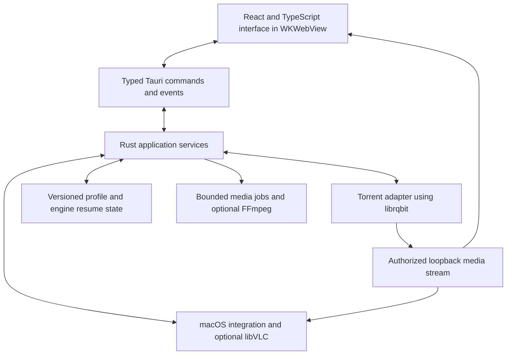

# TorrentCat Tauri rebuild plan

Create a new macOS application in this project, with Rust application services and the same interface and workflows as the local TorrentCat fork. Use **Tauri 2 with React and TypeScript**, evaluate **librqbit 9.0.1** as the torrent engine, and preserve both built-in playback and optional native VLC. Prove torrent and playback compatibility before rebuilding the full interface.

This plan was written before implementation on October 15, 2026. A working macOS preview has since been implemented; see [README.md](../README.md) for the current feature set, run instructions and remaining gaps. This plan is not a completed compatibility certification.

## Baseline and scope

The reference is `/Users/eliaquin/develop/webtorrent-desktop`, version **0.27.7**, commit **86a5f8deef3dec27c78d8796e18ddf8231c26a05**, with a clean working tree when inspected. It is Eliaquin's local fork, not upstream WebTorrent Desktop. The new project starts in `/Users/eliaquin/develop/torrent-cat`.

The fork currently uses Electron 44.7.0, WebTorrent 3.0.21 and React 19.3.0. Its manifest contains 12 direct runtime dependencies, 19 development dependencies and two optional packaging dependencies. Its lockfile has 485 package entries excluding the root; that includes development and optional packages, so it is not a shipped-package count. There are 96 JavaScript source files and 1,217 lines in the main stylesheet.

The baseline already has a refreshed poster library, custom UI components, native VLC, subtitle extraction, audio conversion, isolated renderer windows, a torrent utility process, and Mac release automation. **AirPlay, Chromecast and DLNA are already removed and remain out of scope.** A dependency comparison against upstream's older package manifest would give the wrong requirements.

Proposed first release: macOS 13 or later, with separate Apple Silicon and Intel builds. This minimum is a proposed product choice aligned with the fork's native VLC requirement, not a claim that its entire current app requires macOS 13. Validate the chosen Rust, Tauri and codec stack on the oldest supported OS. Linux and Windows implementation and distribution come later.

Source inspection establishes the feature inventory below. Live inspection of the installed app timed out, so screenshot baselines and direct visual comparison remain a Phase 0 task.

## Framework decision

**Use Tauri.** It supports the existing HTML/CSS/React presentation model and a Rust backend, with the system webview instead of a bundled browser engine. On macOS that webview is WKWebView. React remains a UI dependency; Node is only a development/build tool. This is a fresh application architecture with the existing visual design, rather than a port of Electron's process and IPC structure. [Tauri overview](https://v2.tauri.app/start/), [webview versions](https://v2.tauri.app/reference/webview-versions/).

Alternatives do not offer a better overall fit for these requirements:

| Option | Assessment for this project |
| --- | --- |
| Tauri with React and TypeScript | Recommended. Closest route to the same interface, Rust services and later desktop portability. |
| SwiftUI/AppKit | Worth considering for a permanently Mac-only product. A separate UI strategy would be needed for Linux and Windows, and reproducing the web interface takes more work. |
| Slint | A viable native Rust UI option, but adopting its UI model means rebuilding the styling and interactions with less reuse. Reconsider only if removing the webview becomes more important than interface parity. |
| egui | A viable Rust GUI toolkit, but its immediate-mode model is a less natural match for this existing media-library design. |

These are project-fit judgments, not comparative performance benchmarks. [Slint](https://slint.dev/), [egui](https://github.com/emilk/egui).

## Feature parity contract

Every row becomes an acceptance checklist. A milestone demo may be incomplete; the replacement release must implement the row or explicitly record the accepted difference.

| Area | Behavior to preserve |
| --- | --- |
| Library | Poster shelves, responsive sizing, All/Downloading/Seeding/Paused filters, search, empty states, progress, speeds, peers, stream/pause/resume actions, expanded file lists and per-file selection. |
| Torrent input | File picker, drag and drop, paste, magnet links, HTTP(S) torrent URLs, hex/base32 info hashes, existing `stream-magnet:` handling and instant.io address normalization. Duplicate additions are harmless. Normalizing an instant.io URL does not establish browser-peer compatibility. |
| Transfers | Multiple transfers, seeding, pause/resume including bulk actions, persistence, individual file selection, global trackers, export torrent/magnet, reveal/open files, remove from library separately from removing data. |
| Recovery | Restart with partial data, missing-volume warning, reconnect/retry, locate existing data and verify it, interrupted shutdown, low disk space and permission failures. |
| Creation | File/folder selection, current multi-file semantics, trackers, private flag, comment, save metadata and seed the original files in place. |
| Playback | Play before completion, seek into unavailable pieces, progress/buffering, resume position, next/previous media, volume, rate controls, fullscreen, float on top, keyboard shortcuts, media controls and external-player fallback. Match the existing supported rate range where each backend permits it. |
| Native VLC | Optional user-installed VLC 3, architecture validation, discovery after installation without restarting, embedded output beneath the existing controls, track selection, clean teardown and fallback. |
| Subtitles and audio | SRT/VTT imports and encoding behavior, embedded text subtitles after file completion, language labels, audio-track selection, cached AAC conversion for the built-in player, original torrent bytes preserved for seeding. Preserve the existing WebVTT path's limitations for image subtitles and full ASS styling. |
| Metadata | Audio title/artist/album and technical information, cover art and generated video posters, graceful fallback to filename. |
| Preferences | Folders, Playback, General and Trackers sections; watch folder, download folder, prioritizing streaming, external-player path, login startup, sounds and default-handler action. |
| Mac integration | Application/menu/context menus, dock behavior, notifications, open-file/open-URL events, clipboard, shortcuts, sleep prevention during playback, window lifecycle and single-instance behavior. |
| Updates | Startup and six-hour checks, manual check, Download/Not now/Skip, deferral during playback/dialogs, architecture-correct download links and manual installation. |
| Privacy | Local diagnostics, no automatic crash uploads, loopback-only media access and no LAN control server. |

Evidence: the fork's [README](/Users/eliaquin/develop/webtorrent-desktop/README.md), [torrent service](/Users/eliaquin/develop/webtorrent-desktop/src/engine/torrent-service.js), [library page](/Users/eliaquin/develop/webtorrent-desktop/src/renderer/pages/torrent-list-page.js), [preferences](/Users/eliaquin/develop/webtorrent-desktop/src/renderer/pages/preferences-page.js), [creation page](/Users/eliaquin/develop/webtorrent-desktop/src/renderer/pages/create-torrent-page.js), [player](/Users/eliaquin/develop/webtorrent-desktop/src/renderer/pages/player-page.js), [menus](/Users/eliaquin/develop/webtorrent-desktop/src/main/menu.js) and [tests](/Users/eliaquin/develop/webtorrent-desktop/test).

## Rust torrent engine evaluation

| Candidate | Findings | Decision |
| --- | --- | --- |
| `librqbit` 9.0.1 | Rust library with an existing Tauri desktop application. Documents streaming with range-based seeking and piece prioritization, persistence, selection, DHT, PEX, tracker support and uTP. Apache-2.0. | First choice for a compatibility spike. Embed the library behind our own adapter; do not adopt its UI or expose its entire HTTP API. |
| `mtorrent` 0.10.1 | Active Rust alternative; its checklist includes protocol encryption, uTP, DHT, selective and sequential downloads. Its documentation emphasizes Linux builds. | Reserve candidate if rqbit fails a required networking case. First prove Mac builds and a seekable stream over incomplete data; sequential download alone is insufficient. |
| `cratetorrent` | Its README explicitly requires Linux and lists DHT and magnet support as future work. | Reject for the Mac-first baseline. |
| `lava_torrent` 0.11.1 | Parses, writes and creates torrent metadata; it is not a transfer engine. Its documentation includes a correctness caution. | Conditional helper for torrent creation only, with fixture validation. |
| C++ libtorrent through Rust FFI | Would retain a substantial non-Rust engine and native build integration. | Escalation option only if Rust engines cannot meet essential requirements; not the proposed foundation. |

Sources: [rqbit](https://github.com/ikatson/rqbit), [librqbit API](https://docs.rs/librqbit/latest/librqbit/), [mtorrent feature checklist](https://raw.githubusercontent.com/DanglingPointer/mtorrent/main/README.md), [cratetorrent limitations](https://raw.githubusercontent.com/vimpunk/cratetorrent/master/README.md), [lava_torrent](https://docs.rs/lava_torrent/latest/lava_torrent/). Crates.io metadata confirmed the librqbit and mtorrent versions above; pin the selected versions and toolchain during implementation rather than depending on a moving branch.

### Compatibility gaps to resolve first

1. **WebRTC browser peers:** the fork's lockfile includes WebRTC support through `webrtc-polyfill` and `node-datachannel`. No ready WebTorrent-compatible browser-peer transport was established for the recommended engine. Treat this as unsupported until demonstrated. Ordinary BitTorrent transfer remains the intended baseline, but browser-only swarms would be a real compatibility reduction. Rust's `webrtc` crate supplies protocol building blocks, not a complete WebTorrent engine; tracker signaling, data-channel transport and engine integration would be substantial separate work. [webrtc-rs](https://github.com/webrtc-rs/webrtc).
2. **Web seeds, NAT-PMP and less common protocol behavior:** do not infer these from general BitTorrent support. The inspected librqbit crate did not establish WebRTC, web-seed or NAT-PMP support. Compare HTTP web seeds, tracker variants, private swarms, IPv6 and router behavior against the actual fork in fixtures. A missing engine feature must have a concrete consequence recorded; do not silently drop it.
3. **Torrent creation:** librqbit's current `CreateTorrentOptions` exposes name, trackers and piece length, but not private/comment. Its creation entry point takes one path. Prototype the fork's file-selection semantics and seeding paths. Prefer extending its metadata primitives where practical; use `lava_torrent` only if that produces a smaller reliable adapter. Set the private flag before calculating the final info hash; preserve raw info bytes when importing existing torrents. [Creation options](https://docs.rs/librqbit/latest/librqbit/struct.CreateTorrentOptions.html), [alternative builder](https://docs.rs/lava_torrent/latest/lava_torrent/torrent/v1/struct.TorrentBuilder.html).
4. **Priority behavior:** verify that seeking changes piece demand promptly while other torrents continue. The preference to prioritize playback must have an actual backend effect.
5. **Resume state:** WebTorrent state cannot be treated as rqbit fast-resume data. Import paths and metadata, then verify existing bytes and create new engine resume state.

WebRTC is the largest potential networking scope decision. The default plan does not add a Node/WebTorrent sidecar, because that would retain the runtime being removed. A preview can document this limitation; a final parity claim cannot hide it.

## Dependency replacement map

These rows cover all 12 direct runtime packages in the fork and its significant native/application services. Versions shown are research snapshots, not a proposed lockfile.

| Current dependency or service | Proposed replacement | Qualification |
| --- | --- | --- |
| Electron and Electron packaging tools | Tauri 2, Cargo and Tauri bundling | Keep Node tooling for frontend development only. |
| `webtorrent` | `librqbit` 9.0.1 + `tokio` | Engine adapter; gaps above are release gates. |
| `parse-torrent` | librqbit metadata/magnet types + `url` | Retain application-specific address normalization and validation. |
| `create-torrent` | librqbit creation/metadata primitives; conditional `lava_torrent` | Private flag, comments and arbitrary selections require an adapter. |
| `bitfield` | Engine statistics and piece availability | Keep bitsets in Rust; use `bitvec` only if application logic needs it. Do not serialize the entire bitfield every second. |
| `chokidar` | `notify` 8.2.0 | Add stable-file detection, debounce and deduplication; ignore existing files on initial watch as the fork does. |
| `music-metadata` | `lofty` 0.25.4, FFprobe fallback | Check format coverage. Incremental metadata on an incomplete torrent needs bounded reads and a seek adapter or deferral; it is not a drop-in API. |
| `iso-639-1` | `isolang` 2.4.0 | Retain the fork's filename/content labeling rules as application logic. |
| `pathe` and Node path/fs | Rust `Path`/`PathBuf`, `std::fs`, `tokio::fs` | Native paths stay in Rust; the frontend receives display fields and opaque IDs. |
| `react`, `react-dom` | Retain React; write new TypeScript components | Reproduce the existing DOM/CSS design without its dispatcher/controller architecture. |
| `semver` | Rust `semver` | Parse only supported release versions and validate release URLs. |
| `winreg` | None for macOS | Add Windows integration when that platform enters scope. |
| Custom atomic JSON profile | `serde`/`serde_json` + serialized atomic file writes | Keep a small versioned JSON profile and backup initially. A database is unnecessary for the current feature set. |
| HTTP and local media service | `reqwest` for outbound requests; `axum` + engine stream for local media | Media-only loopback endpoint with range handling and per-session authorization. |
| SRT/VTT conversion | `subtp` 0.2.0 + `encoding_rs` + application conversion rules | Preserve UTF-16 BOM/UTF-8/Windows-1252 handling, cue styling and top-alignment behavior tested in the fork. |
| Embedded subtitle extraction and AAC copies | Optional FFmpeg/FFprobe subprocesses launched by Rust | These remain native external tools. No pure-Rust drop-in replacement for the complete current media workflow was established. |
| Native N-API VLC bridge | Narrow Rust libVLC FFI + `libloading` + `objc2-app-kit` | Preserve runtime loading of installed VLC; replace Node bindings and native-window glue. |
| Posters | FFmpeg frame extraction; Rust image processing only where needed | Preserve original files and bound background work. |
| Dialogs, clipboard, opening files/URLs, autostart | Tauri plugins plus focused Mac adapters | Avoid broad frontend filesystem or shell permissions. |
| Native menus, tray/window state and notifications | Tauri APIs/plugins | Map only the baseline's actual Mac behavior. |
| Deep links and `.torrent` association | Tauri configuration/deep-link plugin + Mac open events | Scheme registration is configured at build time on Mac. Making the app the preferred handler is a separate Launch Services integration task. |
| Power inhibition and media keys | Focused macOS APIs through Rust bindings | Validate media-session support in WKWebView; use a native adapter if needed. |
| Update checks | `reqwest` + `semver`, existing prompt behavior | Keep manual download/install initially. Tauri's automatic updater would be a separate behavior change. |
| Logging/errors/concurrency | `tracing`, `thiserror`, `tokio` | Bounded local logs, explicit cancellation and small typed errors. |

Primary references: [Lofty formats](https://docs.rs/lofty/latest/lofty/), [notify](https://docs.rs/notify/latest/notify/), [isolang](https://docs.rs/isolang/latest/isolang/), [subtp](https://docs.rs/subtp/latest/subtp/), [libloading](https://docs.rs/libloading/latest/libloading/), [AppKit bindings](https://docs.rs/objc2-app-kit/latest/objc2_app_kit/), [FFmpeg](https://ffmpeg.org/ffmpeg.html), [Tauri plugins](https://v2.tauri.app/plugin/), [deep linking](https://v2.tauri.app/plugin/deep-linking/).

Do not add Symphonia just to obtain audio metadata: it is useful for Rust audio decoding, but does not replace the complete video/VLC/FFmpeg pipeline. [Symphonia](https://docs.rs/symphonia/latest/symphonia/).

## Playback strategy

Preserve the existing player controls and two in-app modes. Put backend selection behind one playback interface: open, close, play/pause, seek, volume, rate, tracks, subtitles, geometry and events.

| Backend | Role | Main work |
| --- | --- | --- |
| WKWebView HTML media | Default built-in player for verified formats | Establish actual codec/container support, seeking, track APIs and fullscreen behavior on each supported Mac OS. |
| Native libVLC 3 | Optional broader-format playback matching the fork | Rust lifecycle/FFI, NSView composition under WKWebView, input routing, resize, Retina scaling, fullscreen and shutdown. |
| External player | Explicit fallback matching the fork | Safely launch the selected application with an authorized stream URL; manage stream lifetime until playback stops. |

**Do not reuse the current AAC conversion output unchanged.** The fork writes AAC audio plus copied video into Matroska (`.mkv`). Changing the audio codec alone does not guarantee that WKWebView can demux the container or decode the video. Build a capability decision table: direct play; remux compatible video/audio to a supported container; transcode audio where sufficient; otherwise use VLC/external playback. Full video transcoding is additional scope unless the compatibility spike demonstrates it is essential. Cache keys include source identity, tracks and conversion settings, and outputs never replace the seeded files.

The existing `vlc-rs` wrapper is a candidate reference, not an automatic choice: its latest crates.io release is 0.3.0 from 2018. The fork already loads a small libVLC 3 symbol set dynamically. A correspondingly narrow, owned Rust wrapper can preserve optional VLC installation without a build-time VLC dependency, but it introduces unsafe code that needs lifecycle tests. Use Tauri's native webview access and AppKit bindings for composition. Prototype this before assuming HTML controls can layer correctly over native video. [vlc-rs](https://github.com/garkimasera/vlc-rs), [Tauri native webview access](https://docs.rs/tauri/latest/tauri/webview/struct.Webview.html).

`libmpv2` is an alternative if VLC integration proves unreliable. It still wraps a native media engine, adds packaging/rendering work and changes the current optional-VLC contract. It is not the starting recommendation. [libmpv2](https://github.com/kohsine/libmpv2-rs).

A distributable playback spike must test loading installed VLC under hardened runtime and code signing. Do not resolve a dylib-loading failure by silently broadening entitlements; first establish the smallest workable packaging/runtime arrangement. Bundling a media engine is a separate choice with size and third-party notice implications.

## Proposed architecture

Start with one application Rust process plus Tauri's system webview processes. Run networking and I/O asynchronously; keep hashing, metadata parsing and media jobs off the UI thread and bound their concurrency. Avoid recreating a Node service, local daemon, general REST control API, or several overlapping state stores.

This removes the fork's separate utility-process crash boundary. Async tasks are not process isolation, and a native VLC crash can still terminate the host. Test failure recovery and crash-safe persistence explicitly. If engine or codec isolation proves necessary, move that service behind an owned Rust worker process using the same contracts; do not introduce the worker without evidence.

Rust owns torrent identity, paths, persistent state, engine operations and media sessions. React owns presentation, search/filter state and current controls. Send small progress deltas at a bounded rate, plus a resynchronization snapshot after subscription/reconnect. Give playback sessions generation IDs so delayed probe/subtitle/stream results cannot overwrite the next file's state.

Keep three practical boundaries: torrent operations, playback, and OS integration. Start as modules in a small Rust workspace; do not turn every concern into a crate. Suggested layout: frontend under `src/`, Tauri setup under `src-tauri/`, and a framework-independent Rust core for engine/profile/media logic when shared tests justify it.

The media endpoint binds an ephemeral loopback port, serves only authorized torrent files, uses per-session unguessable tokens, validates Host and permitted Origin values, and supports HEAD and byte ranges with correct 206/416 responses. Establish the real Tauri origin in packaged builds rather than copying Electron's `null`-origin rule. Revoke streams on stop, removal and shutdown. Never expose rqbit's administration endpoints to arbitrary local web pages or the LAN.

## Existing library migration

The fork's default Mac profile is `~/Library/Application Support/WebTorrent`, despite the TorrentCat name. A configured `WEBTORRENT_CONFIG_PATH` can override it. Migration must understand this intentionally, rather than guessing a TorrentCat folder. [Profile path logic](/Users/eliaquin/develop/webtorrent-desktop/src/config.js), [profile persistence](/Users/eliaquin/develop/webtorrent-desktop/src/main/state-storage.js).

Use a distinct bundle identifier and profile directory during development. Offer a one-time import from the old profile: torrent metadata, paths, selections, paused/resume intent, playback positions, posters and supported preferences. Read from a stable snapshot with the old app closed, preserve the source and write an import journal/version so retries are idempotent.

Existing download data can be reused after verification. Engine-specific modtime/bitfield assumptions are not imported as trusted completion. Missing locations remain recoverable and do not trigger downloads into an unintended folder. Conversion caches can be rebuilt, especially because the output container may change. Do not let both apps write the same active download files concurrently. The old app and profile remain usable for rollback.

## Implementation sequence and completion gates

### Phase 0 — Freeze the reference

- Capture library, details, preferences, creation, player, track menus, dialogs, update prompts and error/recovery states from the fork, at fixed window sizes and Retina scale.
- Extract design tokens and reusable icons/assets from the current CSS. Use clean new components; retain required attribution for reused assets or source.
- Convert the feature table into traceable scenarios, using the existing tests as behavior evidence.
- Record release-build size, startup-to-usable time, idle CPU and total process-tree memory, plus playback/transfer metrics. Use synthetic profiles and a controlled local seed.

**Exit:** an executable acceptance inventory and visual baseline tied to the reference commit. No redesign is required to proceed.

### Phase 1 — Prove the risky integrations

- Minimal Tauri shell with librqbit: magnet resolution, download, selection, pause, restart, seed and seekable incomplete-file streaming.
- Interoperate with the existing fork in both directions using controlled content; test tracker-only/private cases, web seeds and browser-only peers separately.
- Create/export a private torrent with a comment and verify identity and seeding paths in another client.
- Play MP4/H.264/AAC, WebM, MKV/H.264, HEVC samples, unsupported-audio samples, multi-track video and subtitle fixtures through the proposed backends. Record successful combinations rather than relying on extensions.
- Show native VLC under the same controls; test resizing/fullscreen, repeated open/close and a signed packaged build on both CPU architectures.
- Validate the frontend testing approach in the actual Mac webview.

**Exit:** engine and playback decisions backed by recorded results, with every difference classified as solved, additional implementation, or a proposed explicit exception. If core streaming or embedded VLC fails, resolve that architecture issue before building the full UI.

### Phase 2 — Application foundation

- Establish reproducible frontend/Rust builds, pinned dependencies, module boundaries and typed command/event contracts.
- Add atomic profile storage, cancellation, bounded local logs, window lifecycle, command authorization and a narrow media server.
- Build the new shell/navigation and visual components using deterministic fixture state.

**Exit:** the app launches with the reference layout, survives interrupted writes and reconnects UI state correctly. No Electron or Node runtime is shipped.

### Phase 3 — Torrent and library parity

- Implement the library, all input paths, torrent/file actions, tracker preferences, watch folder, creation/export and recovery flows.
- Add migration preview/import and data verification; preserve paused intent and missing-path states.
- Implement menus, context menus, drag/drop and transfer notifications as each workflow becomes functional.

**Exit:** torrent and migration scenarios pass against controlled peers and synthetic profiles, including remove-versus-delete behavior and interrupted resume.

### Phase 4 — Playback parity

- Implement the shared player UI, built-in/native/external adapters, playlist, resume, buffering, seeking, rate and volume.
- Complete track/subtitle handling, metadata/posters, compatibility conversions, optional-tool discovery and error messages.
- Test stale asynchronous events, rapid switching, incomplete files, sleep/wake and background transfers during playback.

**Exit:** the agreed media fixture matrix passes on Intel and Apple Silicon, and original seeded data remains unchanged after conversion or playback.

### Phase 5 — Mac integration and release readiness

- Finish default-handler behavior, cold/warm open events, startup, dock, power inhibition, media keys and update-prompt parity.
- Build signed/notarized DMGs for both architectures, staple and verify them, then install and run on clean machines with and without VLC/FFmpeg.
- Use a new release destination for the new application; do not point its updater at the Electron fork's artifacts.
- Check visual parity, accessibility/keyboard behavior, dependency licenses and performance against Phase 0.

**Exit:** a reproducible Mac release candidate with passing acceptance evidence, migration/rollback instructions and a short explicit list of any accepted compatibility differences. Publication is a later delivery action, not part of this planning task. [Tauri Mac signing](https://v2.tauri.app/distribute/sign/macos/).

### Later — Linux and Windows

Reuse the Rust core and frontend. Add OS-specific playback surfaces, handlers, paths, power integration and packaging; test each platform's webview codec capabilities independently. Keep platform-specific code behind the OS/playback boundaries from the start without building unused platform features now.

## Verification and measures of success

- Rust unit/integration tests for real failure boundaries: address normalization, private creation, path safety, profile migrations, cancellation, selection, resume, HTTP ranges and stream authorization.
- Controlled torrent fixtures with private/local trackers or explicit local peers; disable public discovery in automated tests. Exercise malformed metadata, lost peers, partial files and unexpected shutdown.
- Frontend component tests and screenshot comparisons using stable fixture state. Run actual Tauri Mac end-to-end tests with WebdriverIO's embedded Tauri driver; current Tauri documentation supports this on macOS. The standalone `tauri-driver` route alone does not. Compile test-control plugins out of production releases. [Tauri WebDriver guidance](https://v2.tauri.app/develop/tests/webdriver/).
- Native/manual smoke checks for Finder associations, menus, VLC surfaces, audio output, fullscreen, screen scaling, signing and real media. Browser-only tests cannot certify these integrations.
- Repeat performance measurements with the same profile, hardware and workload. Include all WebKit helper processes and optional codec processes in memory totals. Record first-frame time, seek recovery, transfer throughput and energy impact as well as installed/DMG size.

Proposed improvement targets, to calibrate after Phase 0: at least 50% smaller base application bundle and 30% lower idle process-tree memory than the fork; startup and controlled transfer/seek behavior should not materially regress. These are goals, not measured results or Tauri guarantees. Report installed optional-tool size separately so externalizing VLC/FFmpeg does not create misleading savings.

## Decisions carried forward

Tauri is the selected direction. React/TypeScript is the proposed presentation layer; Rust owns application services. librqbit is the leading engine subject to Phase 1. Preserve optional installed VLC and FFmpeg initially to match the fork and keep the base bundle small. Use a fresh profile with an importer, and preserve manual update installation.

The first implementation task should be the **torrent streaming and signed native-player spike**, after capturing the reference fixtures. The unresolved items are browser-peer/web-seed compatibility, exact WebKit media coverage, full torrent-creation semantics and native video composition. Resolving those first determines whether the remaining work is a straightforward rebuild or requires a deliberate feature tradeoff.
